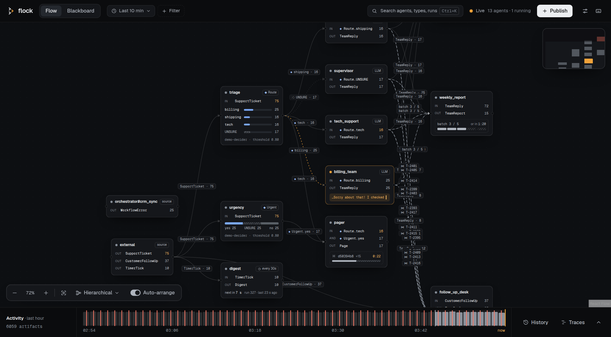
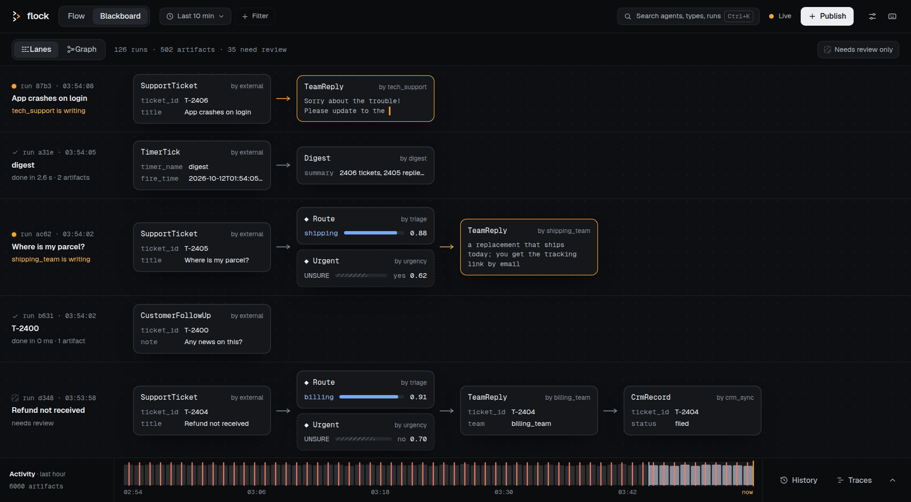

# Dashboard

The dashboard shows a flock while it runs: which agents work, what they consume and publish, what the decision models answered, and every run on the blackboard. You can publish artifacts from it, review unsure decisions, and follow a run's traces, without writing code.

<p align="center">
  
  <i>The Flow: agents as cards, decisions as bars, edges with what went along them</i>
</p>

---

## Start it

```python
await flock.serve(dashboard=True)
```

`serve()` builds the frontend on first use, starts the REST API and the dashboard on `http://localhost:8344`, and keeps a WebSocket open for live updates. `port=` and `host=` change where it listens.

To publish and run after the server is up, start it without blocking:

```python
await flock.serve(dashboard=True, blocking=False)

await flock.publish(Idea(topic="cats in space"))
await flock.run_until_idle()
```

**A demo with every state, without API keys:** `uv run python examples/04-misc/10_dashboard_triage_demo.py` runs a ticket triage with decisions, streaming replies, joins, batches, a timer, failures and reviews. Use it to look around, or `--port 8345` to compare two dashboards on the same data.

---

## The header

One row, from left to right:

| Element | What it does |
|---|---|
| **Flow / Blackboard** | The two views (Ctrl/⌘+M switches) |
| **Scope chips** | The time range, one chip per active filter (× removes it), and **+ Filter** with every facet: correlation, types, producers, tags, visibility, and saved presets (Ctrl/⌘+Shift+F) |
| **Search** | The ⌘K palette (Ctrl/⌘+K) |
| **Live** | The connection: *Live* with the agents and how many run, *Reconnecting (n)*, or *Offline*; a banner on the board while the connection is lost |
| **Publish** | The publish composer (Ctrl/⌘+Shift+P) |
| **Settings, shortcuts** | The settings sheet (Ctrl/⌘+,) and the keyboard shortcuts (Ctrl/⌘+/) |

The filters apply to both views and to the timeline dock's activity strip and History; Traces has a search of its own, and Metrics counts every loaded trace.

---

## The Flow

The Flow shows the agents and how artifacts move between them.

- **Agent cards:** a status dot (amber while it runs, coral after a failure), the name and a tag (`LLM`, `source`, `◆ Route` for a decider, the schedule of a timer agent). Below it, its ports: `IN` per subscription (`AND` and `JOIN` rows for AND gates and joins), `OUT` per published type, each with a count that flashes when it changes. A running agent shows the tail of what it writes; a join or batch shows what it waits for and its countdown.
- **Deciders** show their answers as bars per option, with the threshold; uncertainty is hatched.
- **Sinks** (see [Sinks](sinks.md)) carry their method and path as the tag (`↗ POST /billing`) and count their deliveries: delivered, failed (coral) and the last answer. Unfolded, the Overview shows the counts and why the last delivery failed.
- **Edges** carry what went along them (`SupportTicket · 75`, `◆ billing · 25`); they move while an artifact is on its way.
- **Zoomed out**, cards become chips with the name and status.

**Unfold** an agent in place with a click, Space or Ctrl/⌘+Shift+D: its tabs Overview (what it does, a decider's answers and its review queue, runs, failures, tokens and cost), Live, History, Runs and Traces. Its neighbours make room. Esc folds it.

**Focus** an agent with a double click, Enter, or the focus button of an unfolded agent: a full stage over the dimmed board, with its lineage (what it consumes and who consumes what it publishes) and the same tabs with more room. Esc leaves.

**The canvas dock** (bottom left): zoom, fit, the layout menu (hierarchical left to right or top down, circular, grid, random) and **Auto-arrange**, which lays the board out again when agents or edges appear. The minimap sits top right.

---

## The Blackboard

The Blackboard shows the artifacts themselves, as **Lanes** or as a **Graph**.

<p align="center">
  
  <i>The Blackboard as lanes: one lane per run, newest on top</i>
</p>

**Lanes:** one lane per run (correlation ID), newest on top. The lane's header says how the run stands: which agent is deciding or writing, *needs review* for an unsure decision no one reviewed, or *done in 2.3 s · 5 artifacts*, in coral with *· 1 delivery failed* when a sink could not deliver one of the run's artifacts. Artifacts follow left to right as cards: their type, producer and two fields of the payload, the decision's answer, or for a sink's receipt where it went and how the target answered (a failed delivery's card is coral). A card that still streams shows the text as it arrives.

**Graph:** the same cards on a canvas, arrows from what a run consumed to what it published (dashed after an unsure decision, amber and moving to a card that still streams). Each run is laid out on its own, top down by default, and the runs fill rows, oldest first; the first view shows the whole board if it reads at that size, else the newest row. Cards stay where they are while the board fills: a run that grows keeps its place, new runs take the next free slot. The canvas dock lays it out again; Auto-arrange is off here by default.

In both:

- **A click unfolds a card in place:** the full decision with its probabilities, the review buttons, model, consumers, visibility and ID, the payload as JSON, and who consumed it when. Esc folds it.
- **Needs review only** narrows the board to the runs with an unsure decision no one reviewed.
- The board holds the newest 500 artifacts for the filters; the timeline dock's **History** has every artifact.

---

## Decisions

A decision model's answers (see [Decision models](decisions.md)) show wherever they appear: on the decider's card, in its unfolded Overview, and as cards on the Blackboard.

- **Choices** as bars per option with the threshold; **yes/no** as one bar with the unsure zone hatched; **scales** as columns; **checklists** as a row of cells, failed items coral.
- **Escalation, votes and shadow models** as chips per tier, per model, or a dashed chip with the agreement so far; **explanations** with their text.
- **Tournaments** show their rounds; *Open bracket* shows the whole bracket.
- **Review:** an unsure decision has review buttons with the best guess preselected. A review publishes a decision of the person (`review_of`) that routes like any other. The decider's Overview lists the decisions that wait for a person.

---

## The timeline dock

The strip at the bottom shows the last hour's activity for the board's filters: artifacts per minute, failed workflows and failed deliveries marked. Dragging over it sets the time range. Its tabs open it upwards:

- **Traces:** the traces with their spans as a waterfall, and every span's input and output. Its search takes free text and `agent:billing_team`, `status:error` or `service:DecisionEngine`, not the board's filters; a trace link anywhere in the dashboard opens it here on that run. Tracing needs `FLOCK_AUTO_TRACE=true` (see [Tracing](tracing/index.md)).
- **History:** every artifact, newest first, with *Load older*.
- **Metrics:** rate, errors and durations per service, and who calls whom, from the loaded traces.
- **Tracing settings:** which services and operations are traced.

While the dock is open the board is a strip: it fits what was in view, and gives the view back when the dock closes.

---

## Publish an artifact

**Publish** (or Ctrl/⌘+Shift+P) opens the composer:

1. Pick a type on the left: your types, the decisions, and (collapsed) the system types; the search finds them, the arrow keys move.
2. Fill in its form: every field with its type and description, pictures for `Image` fields (scaled in the browser), lists one item per line. **JSON** edits the payload as JSON, checked against the schema before it is sent.
3. **Picked up by** shows the agents subscribed to the type, and which run after them.
4. **Publish** (Ctrl/⌘+Enter). With *Follow this run on the board* (on by default) the board filters to the new run; the toast's *Stop following* lifts the filter.

---

## The palette

Ctrl/⌘+K opens one search over agents, types, runs and commands.

- **Agents:** Enter shows it on the Flow, Shift+Enter unfolds it, Ctrl/⌘+Enter puts it in focus.
- **Types:** Enter filters the board by the type, Shift+Enter opens the composer on it.
- **Runs**, found by the start of their correlation ID: Enter filters the board by the run, Shift+Enter shows its lane.
- **Commands:** the other view, publish, filters and time ranges, the canvas dock (zoom, fit, layouts, auto-arrange), the timeline dock's tabs, settings, shortcuts, and themes.

The footer shows the active result's actions as buttons too.

---

## Settings and themes

The settings sheet (Ctrl/⌘+, or the header's button) has three tabs:

- **Graph:** edge type, width, motion, and labels on the edges.
- **Appearance:** **Graphite** (dark, the default) and **Paper** (light), or one of 300+ terminal themes on top of them. Hovering a theme previews it.
- **Advanced:** node and rank spacing of the Flow's layouts, *Clear all dashboard data* (what this browser keeps: layouts, filters, presets; the blackboard is not touched), and the versions.

---

## Keyboard shortcuts

| Keys | |
|---|---|
| Ctrl/⌘+M | Switch between Flow and Blackboard |
| Ctrl/⌘+K | Search and commands |
| Space, Ctrl/⌘+Shift+D | Unfold or fold the selected agent |
| Enter | Put the selected agent in focus |
| Esc | Leave focus, close a panel, else fold |
| Ctrl/⌘+Shift+P | Publish composer |
| Ctrl/⌘+Shift+F | Filters |
| Ctrl/⌘+, | Settings |
| Ctrl/⌘+/ | These shortcuts |

The shortcuts dialog lists the keys of the composer and the palette too.

---

## Troubleshooting

**The page stays empty.** The first `serve()` builds the frontend, which takes a few seconds; the console shows when the server runs. Check that nothing else listens on the port (`lsof -i :8344`).

**The header says Offline or Reconnecting.** The dashboard retries by itself and loads what was published meanwhile once it is back; *Retry now* in the banner retries at once. If it stays offline, the server stopped: check its log.

**The board looks empty.** Check the scope chips: a time range or a filter may hide everything (*Show all* on the board clears them). The Blackboard holds the newest 500 artifacts; older ones are in the timeline dock's History.

**The Flow is crowded.** Zoom out (cards become chips), use the layout menu, or filter by a run (the palette finds it by the start of its ID).

---

## Next steps

- [Decision models](decisions.md): the questions behind the decision displays
- [Tracing](tracing/index.md): what the Traces tab reads
- [Visibility](visibility.md): what the dashboard may show to whom
- [REST API](rest-api.md): the API the dashboard uses
