---
tags:
  - decisions
  - subscriptions
  - routing
description: Route workflows with decision models - Choice, YesNo, Scale and Checklist questions, .decides() and answer subscriptions
---

# Decision Models

A **decision model** reads a state plus typed questions (one of N options, yes/no, an ordered scale, a checklist) and returns a calibrated probability for every answer, in one forward pass and without generating text. Examples are TypeSafe Jev, Cloudflare Clef (open weights) and Microsoft-Decision-1. For routing, classification and gating they are one to two orders of magnitude cheaper and faster than an LLM call.

In Flock a decision is a **shared fact on the blackboard**: one agent decides once and publishes the decision. Other agents subscribe to an **option** of that decision.

```python
from pydantic import BaseModel

from flock import Choice, Flock, flock_type


@flock_type
class Ticket(BaseModel):
    subject: str
    body: str


@flock_type
class Reply(BaseModel):
    team: str
    reply: str


class Route(Choice):
    """Which team should handle this support ticket?"""

    billing = "Charges, invoices, refunds"
    shipping = "Delivery, tracking, returns"
    tech = "Bugs, crashes, login problems"


flock = Flock("openai/gpt-4.1")

triage = (
    flock.agent("triage")
    .consumes(Ticket)
    .decides(Route, model="azure/decision-1", threshold=0.8)
)

flock.agent("billing").consumes(Route.billing).publishes(Reply)
flock.agent("tech").consumes(Route.tech).publishes(Reply)
flock.agent("supervisor").consumes(Route.UNSURE).publishes(Reply)
```

## Question types

A question class is the question and its answers; its **docstring** is the question sent to the model. The three kinds map to the native question types of the decision APIs:

| Class | Answers | systemone | OpenAI Decisions | Subscription handles |
|---|---|---|---|---|
| `Choice` | one of 2-255 options | `choice` | `choice` | `Route.billing`, `Route.UNSURE`, `Route.ANY` |
| `YesNo` | `yes` or `no` | `noul` | `predicate` | `Urgent.yes`, `Urgent.no`, `Urgent.UNSURE`, `Urgent.ANY` |
| `Scale` | 2-10 ordered levels | `score` | `score` | `Anger.angry`, `Anger.angry.or_higher`, `Anger.annoyed.or_lower`, `Anger.UNSURE`, `Anger.ANY` |
| `Checklist` | yes/no per item, any number of items, one decision | `noul` per item | `predicate` per item | `Controls.passed`, `Controls.failed`, `Controls.mfa`, `Controls.mfa.no`, `Controls.mfa.UNSURE`, `Controls.UNSURE`, `Controls.ANY` |

`UNSURE` and `ANY` are reserved names, and so are `passed` and `failed` in a Checklist.

### Choice

- Every **string attribute** is an option. Its value describes the option and is sent as the option's criteria. Good descriptions matter as much as good prompts.
- Options are static. A Choice needs at least two options. Decision models accept at most 255 options per question; a larger Choice is asked as a [tournament](#tournaments-for-large-choices).
- `Choice.from_options("Route", {"billing": "...", "tech": "..."}, question="...")` builds a Choice from data, for example a catalog loaded at startup.

### YesNo

```python
from flock import YesNo


class Urgent(YesNo):
    """Does the customer need an answer today?"""


class Refund(YesNo):
    """Does the customer ask for a refund?"""

    yes = "They want money back"   # optional: what each answer means
    no = "No refund request"
```

The model returns the probability of yes; the decision carries `probabilities = {"yes": p, "no": 1 - p}`. systemone models receive the descriptions as `noul` criteria. OpenAI predicates take no descriptions, so Flock appends them to the instructions. A YesNo accepts no other attributes.

Ask a yes/no question as `YesNo` rather than as a two-option `Choice`: the native yes/no head of a decision model and its choice head can disagree on the same item.

### Scale

```python
from flock import Scale


class Anger(Scale):
    """How angry is the customer?"""

    calm = "Calm and polite"            # lowest level first
    annoyed = "Annoyed but civil"
    angry = "Angry, complaining strongly"
    furious = "Furious, threatening to leave"
```

A Scale has 2-10 levels in declaration order, lowest first. The decision carries the probability per level, the most probable level as `choice` and the probability-weighted `score`: 0 is the lowest level, 3 the highest here, and 2.2 lies between `angry` and `furious`.

- `Anger.angry` triggers when the most probable level is `angry` (and clears the threshold).
- `Anger.angry.or_higher` triggers when `score >= 2`, `Anger.annoyed.or_lower` when `score <= 1`. These compare the score and ignore the threshold: a decision split between `angry` (0.55) and `furious` (0.45) is `UNSURE` as a level, but its score of 2.45 is clearly "angry or higher".

### Checklist

A Checklist asks the same yes/no question for every item and publishes **one** decision with an answer per item. It is made for checking an artifact against a catalog: a document against security controls, a contract against required clauses, a release against a definition of done.

```python
from flock import Checklist


class Controls(Checklist):
    """Does the document show that this control is implemented?"""

    mfa = "Multi-factor authentication is required for remote access"
    backup = "Backups are performed daily"
    restore_test = "Restores from backup are tested"


# or from a catalog; ids need not be identifiers ("ORP.1.A1" works, via getattr)
Controls = Checklist.from_items(
    "Controls",
    {control["id"]: control["text"] for control in catalog},
    question="Does the document show that this control is implemented?",
)
```

Every item becomes a yes/no question whose instructions are the docstring plus the item text. The more probable answer counts, firm when its probability reaches the threshold: with `threshold=0.8` an item is `yes` at a probability of yes of at least 0.8, `no` at 0.2 or below, and `UNSURE` in between. The decision carries:

- `results`: `yes`, `no` or `UNSURE` per item; `probabilities`: the probability of yes per item;
- `choice`, the outcome: `failed` as soon as one item is `no`, `UNSURE` if no item is `no` but some are unsure, `passed` if every item is `yes`;
- `refused_items`: items the model refused (their result is `UNSURE`).

Subscribe to the outcome (`Controls.failed`), to one item (`Controls.restore_test.no`), or put a `where=` predicate on the decision: `.consumes(Controls.ANY, where=lambda d: "UNSURE" in d.results.values())` routes every document with unsure items to a review, also when the outcome is already `failed`.

Use a Checklist, not a `Choice`, when several items can apply at once. A Choice asks which **one** option applies and spreads the probability over all options: with a policy text that satisfies 11 of 20 controls, Microsoft-Decision-1 put 0.40 on the best control and no option cleared a threshold of 0.8.

Many items are cheap, because the artifact is sent once as the state and each item is a question about it:

| Questions in one request (Microsoft-Decision-1) | Latency |
|---|---|
| 1 | 167 ms |
| 20 | 253 ms |
| 100 | 560 ms |

`.decides(..., questions_per_request=100)` (the default) splits larger checklists into requests of at most that many questions and sends them concurrently. On the example data below (24 documents, 100 controls each, threshold 0.8), Microsoft-Decision-1 found 99 % of the implemented controls (recall 0.99; an unsure answer counts as missed) at a precision of 0.75, about 600 ms per document. Many of the extra "yes" answers are arguable, such as a procedure document counted as documentation of operating procedures.

## Deciding: `.decides()`

```python
.decides(
    Route, Urgent, Anger,       # one or more question classes, asked in one request
    model="azure/decision-1",   # or a DecisionProvider; default: Flock(decision_model=...)
    threshold=0.8,              # optional, for every question; below it a decision is UNSURE
    instructions=None,          # optional, single question only; overrides the docstring
    visibility=None,            # optional; overrides visibility inheritance
    questions_per_request=100,  # optional; larger sets are split into concurrent requests
    tournament=None,            # optional; Tournament(...) asks one large Choice in rounds
    options=None,               # optional; callable(ctx) -> option names asked this time
)
```

`.decides()` sets the agent's engine to a `DecisionEngine` and makes the agent publish one `Decision.of(<question>)` per question. Utilities, guards and tracing work as for any other agent. A decision agent publishes only its decisions: `.decides()` cannot be combined with `.with_engines()` or `.publishes()`, in either order, and batch subscriptions are not supported.

The model sees the agent's inputs as its state, one line per input: `Ticket: {"subject": "...", "body": "..."}`.

### Several questions in one call

With several questions the model answers all of them in **one request**, in one pass over the state, and every execution publishes one decision per question about the same subject. Each question routes on its own:

```python
triage = flock.agent("triage").consumes(Ticket).decides(Route, Urgent, Anger)

flock.agent("billing").consumes(Route.billing).publishes(Reply)
flock.agent("pager").consumes(Urgent.yes).publishes(Page)
flock.agent("deescalation").consumes(Anger.angry.or_higher).publishes(Reply)
```

A ticket that is about billing, urgent and furious runs all three agents, each with the ticket as input. The question classes of one decider need distinct class names.

### The decision artifact

Each decision is a `Decision.of(<question>)` artifact, for example `Decision.of(Route)`:

| Field | Meaning |
|---|---|
| `question` | Name of the question class |
| `kind` | `choice`, `yesno` or `scale` |
| `choice` | The selected option, or `UNSURE` when its probability is below `threshold` or the model refused |
| `best_guess` | The model's pick, also when unsure; `None` when the model refused |
| `probabilities` | Probability per option (per level for a Scale, `yes`/`no` for a YesNo) |
| `score` | Scale only: the probability-weighted level, 0 = lowest |
| `refused` | The model refused to answer this question |
| `results`, `refused_items` | Checklist only: answer per item, items the model refused |
| `rounds` | Tournament only: candidates, groups, refused groups, survivors and the top candidates of every group per round |
| `candidates` | The options the decision was asked about when `options=` restricted them |
| `confidence` | Confidence as reported by the model |
| `threshold` | The threshold that applied |
| `instructions` | The question text asked when `.decides(instructions=...)` replaced the docstring |
| `subject_ids` | Ids of the artifacts the decision is about |
| `model` | The model that answered (as reported by the provider) |
| `tier`, `attempts` | [Escalation](#escalation-cascades): the tier that answered (0 is the decider's model) and the earlier tiers' answers |
| `votes` | [Ensembles](#ensembles-and-voting): every model's answer |
| `mode` | How the decider answers: `"single"`, `"escalation"` (`escalate=`) or `"ensemble"` (`models=`), also when no escalation or vote happened |
| `shadow` | [Shadow mode](#shadow-mode): the shadow model's answer, recorded but not routed |
| `sections` | [Long documents](#long-documents-in-sections): the split field, the sections' spans and the section per answer |
| `review_of` | [Human review](#human-review): the decision a person confirmed or overrode with this one |
| `latency_ms` | Round trip of the decision request (shared by all questions of the request) |

### Tournaments for large choices

Some decisions pick one option out of a large catalog: mapping a paragraph to the requirement it implements, with well over 1,000 requirements in the BSI IT-Grundschutz-Kompendium. A tournament asks such a Choice in rounds:

```python
from flock import Choice, Tournament

Requirement = Choice.from_options("Requirement", catalog, question="Which requirement does this paragraph implement?")

flock.agent("mapper").consumes(Paragraph).decides(
    Requirement, tournament=Tournament(group_size=20, keep=3), threshold=0.6
)
```

1. The options are split into groups of `group_size`; every group is one choice question, and all groups of a round go out together (in requests of at most `questions_per_request` questions). A leftover group of one option cannot be asked as a choice and advances without a request.
2. The `keep` most probable options of each group survive. The tournament keeps a top-k per group instead of applying a threshold, because probabilities are normalized within each group and cannot be compared across groups.
3. Rounds repeat until the survivors fit into one final question. Its answer is the decision: probabilities over the finalists, threshold and `UNSURE` as usual, subscriptions and handles unchanged.

The decision's `rounds` lists every round's candidates, groups, `group_size`, `refused_groups` and survivors, and per group (`group_results`) its size and its top candidates with their probabilities: the survivors plus the two strongest eliminated options. OpenAI's Decisions API refuses a group in which no option fits; such a group keeps no survivors. A Choice with more than 255 options must be asked as a tournament or restricted with `options=`; `.decides()` without either rejects it.

A tournament costs one round trip per round, and an option that drops out early cannot win. On the example below (25 evidence sentences, 100 controls, Microsoft-Decision-1), both fit:

| Decider | Right | Median latency | Requests |
|---|---|---|---|
| one choice over all 100 controls | 25/25 | 180 ms | 1 |
| tournament, groups of 20, keep 3 | 25/25 | 419 ms | 2 |

Use a single choice whenever the options fit into one question, and a tournament or a [screening network](#decision-networks) when they do not.

<p align="center">
  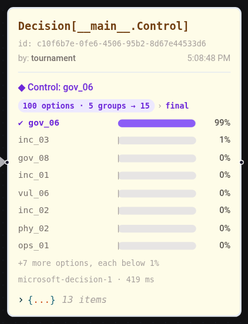
</p>

**⤢ bracket** on a tournament decision opens the whole tournament: one column per round and the final, group boxes with their top candidates, lines from every survivor to its place in the next round, and the winner's path highlighted. Hovering an option traces its path through all rounds:

<p align="center">
  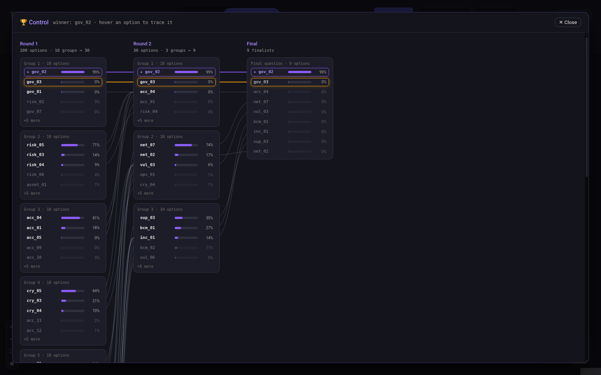
</p>

## Routing: choice subscriptions

```python
flock.agent("billing").consumes(Route.billing)    # one option
flock.agent("supervisor").consumes(Route.UNSURE)   # decisions below the threshold
flock.agent("logger").consumes(Route.ANY)          # every decision
flock.agent("orders").consumes(Route.billing).consumes(Route.shipping)  # OR
```

A choice subscription triggers on matching decisions but **delivers the decision's subject**: the `billing` agent receives the `Ticket`, so its engine signature is `Ticket -> Reply`, exactly as if it consumed `Ticket` directly. The decision is on the context:

```python
class BillingEngine(EngineComponent):
    async def evaluate(self, agent, ctx, inputs, output_group):
        ticket = inputs.first_as(Ticket)
        routed_with = ctx.decision.probabilities["billing"]
        ...
```

Consumption is recorded on the decision artifact, so lineage and the dashboard show `triage → billing`.

To work with the decision itself (for an audit log, for example), consume its type like any other artifact:

```python
flock.agent("auditor").consumes(Decision.of(Route)).publishes(AuditEntry)
```

Handles cannot be mixed with plain types in one `.consumes()` call; several handles mean AND (see [Decision networks](#decision-networks)). One agent cannot consume both a question's handles and its decision type, because a handle delivers the subject and the type delivers the decision; use two agents. `where=` predicates on a choice subscription receive the decision.

## Decision networks

Decisions compose: several handles in one `.consumes()` mean **AND about the same subject**, and `.decides(..., options=...)` asks about a subset of a question's options chosen at runtime. Together they build networks of deciders.

### AND across questions and deciders

```python
# Both questions of one decider
flock.agent("urgent_billing").consumes(Route.billing, Urgent.yes).publishes(Page)

# Decisions of separate deciders about the same ticket
flock.agent("review").consumes(Route.ANY, Sentiment.ANY, Risk.ANY).publishes(Review)
```

The agent runs once a matching decision for every handle has arrived about the same subject. It receives the subject once, and `ctx.decisions` holds all the decisions. Internally this is a join on the decisions' `subject_ids` with a 10-minute window; pass `join=JoinSpec(...)` to change it. Handles of the same question cannot be combined (there is one decision per subject), and handles cannot be mixed with plain types.

### Options at runtime

```python
def passes(ctx):
    return [item for d in ctx.decisions for item, result in d.results.items() if result == "yes"]

flock.agent("ranker").consumes(...).decides(Control, options=passes)
```

`options=` restricts a single Choice or Checklist to some of its options for each execution. The callable receives the context and returns option names. The decision type, its handles and routing stay as declared, and the decision records the `candidates` in declared order.

- Names that are not options of the question fail the execution, and so do more than 255 candidates of a Choice without `tournament=`.
- No candidates give an `UNSURE` decision without a request (not marked as refused).
- A single candidate wins without a request.

### A screening network

Separate screen nodes each check a slice of a catalog in parallel. A ranker waits for all screens of a document, receives the document itself and ranks the controls that passed:

```
                  ┌── screen_001_025 ──┐
EvidenceSentence ─┼── screen_026_050 ──┼──> ranker ──> Decision[Control]
                  ├── screen_051_075 ──┤
                  └── screen_076_100 ──┘
```

```python
SCREENS = [
    Checklist.from_items(f"Screen_{s + 1:03d}_{s + 25:03d}",
                         {c["id"]: c["text"] for c in catalog[s : s + 25]},
                         question="Does this statement show that this control is implemented?")
    for s in range(0, 100, 25)
]
for screen in SCREENS:
    flock.agent(screen.__name__.lower()).consumes(EvidenceSentence).decides(screen, threshold=0.5)

flock.agent("ranker").consumes(*(s.ANY for s in SCREENS)).decides(Control, options=passes)
```

Screens are yes/no checklists rather than choices. A choice spreads its probability over its own slice, so an unrelated screen would still pass some option; yes/no answers are comparable across screens, which a threshold needs. Every screen is its own node, with its own model, threshold and scaling, and the dashboard shows each step:

<p align="center">
  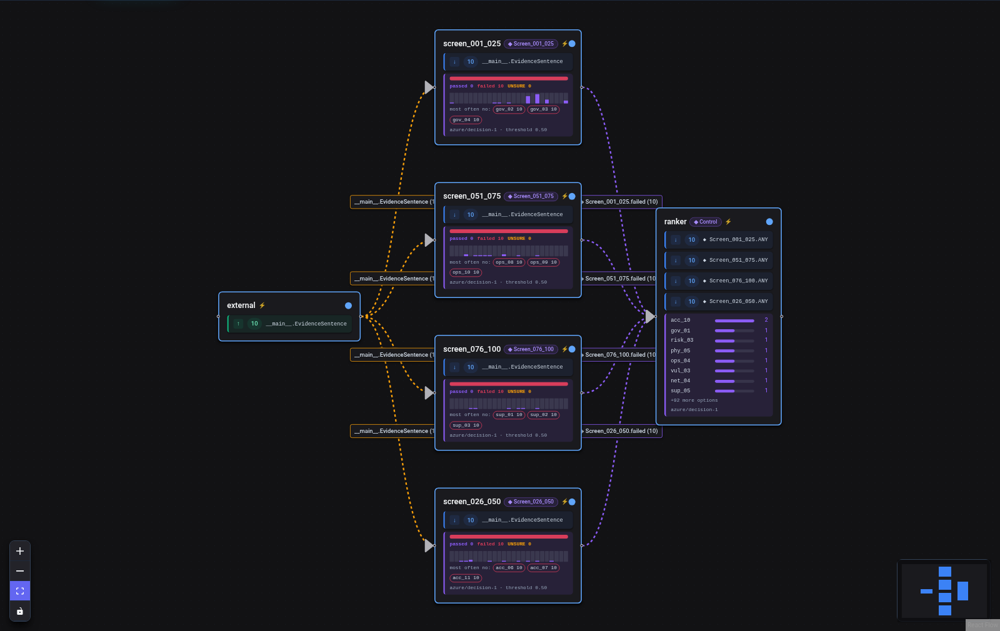
</p>

<p align="center">
  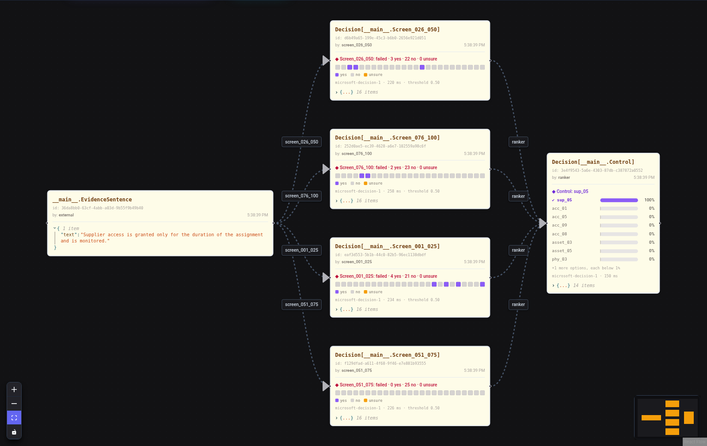
</p>

### Choosing one of many options: three ways

[`06_control_mapping_tournament.py`](https://github.com/whiteducksoftware/flock/blob/main/examples/15-decisions/06_control_mapping_tournament.py) runs all three on the same 10 evidence sentences and 100 controls (Microsoft-Decision-1):

| Way | Right | Median latency | Requests per sentence | When to use it |
|---|---|---|---|---|
| One choice | 10/10 | 182 ms | 1 | The options fit into one question (up to 255) |
| Tournament in one node | 10/10 | 388 ms | 2 | A large catalog, as one decision with a bracket |
| Screening network | 10/10 | 441 ms | 5 | Separate steps, each with its own model, threshold and scaling; screens that are useful on their own |

The network's latency is its slowest screen plus the ranker. The right control was among the network's passes for every sentence, with a median of 5 passes per sentence.

### Coverage across artifacts

A checklist answers per artifact. With a catalog of 100 controls, a single policy never shows all of them, so every document fails. The question that matters is per organisation: is each control shown by *any* of its documents? An aggregating agent answers it:

```python
from flock.decisions.coverage import Coverage

flock.agent("audit").consumes(Document).decides(Controls, threshold=0.8)
flock.agent("coverage").consumes(Controls.ANY).aggregates(by="organisation", combine="any")
flock.agent("gaps").consumes(Coverage.of(Controls), where=lambda c: c.choice == "failed")
```

Every checklist decision that reaches the agent is added to the group of its decided artifact: `by` names a field of the artifact (`"organisation"`) or is a function of it. After each decision, the agent publishes the group's `Coverage.of(Controls)`:

| Field | Meaning |
|---|---|
| `group` | The group's key |
| `combine` | `any` or `all` |
| `results` | Combined answer per item |
| `choice` | `passed`, `failed` or `UNSURE`, as for a checklist decision |
| `evidence` | Per item, the artifacts that showed it |
| `subject_ids`, `decision_ids` | The artifacts and decisions in the group |
| `revision` | How many decisions were combined |

With `combine="any"` (default) an item is yes if any artifact shows it and no only if all say no; with `combine="all"` it is yes only if every artifact shows it and no if any says no. Anything else is `UNSURE`.

Coverage is published per decision. Concurrent executions can store them out of order, so the coverage with the highest `revision` is a group's current one. The groups live in the agent and are also filled from its context (the decisions its subscriptions would receive). With the default context provider, which shows the agent every visible artifact, a restart with a persistent store loses nothing; a narrower provider set with `.with_context()` or `Flock(context_provider=...)` narrows what a restarted agent recovers; updates run one at a time, so the last coverage holds every decision. A coverage keeps the group's common visibility; for groups with different visibilities, `visibility=` on `.aggregates()` sets the readership. `.aggregates()` needs subscriptions to the handles of one Checklist only, and cannot be combined with `.publishes()`, `.with_engines()` or batch subscriptions.

On the 24 documents of 12 organisations from the compliance example ([`11_coverage.py`](https://github.com/whiteducksoftware/flock/blob/main/examples/15-decisions/11_coverage.py), Microsoft-Decision-1, threshold 0.8), the coverage per organisation agrees with the ground truth on 80 to 92 of the decided controls; "shown" has recall 0.99 (an unsure control counts as missed) and precision 0.78, and 104 of the 1,200 controls stay unsure.

In the dashboard, the aggregating agent counts the groups in view by the outcome of their newest revision, also when that revision is outside the view (which groups count follows the view's filters and limit, as for a decider's counts), and a coverage shows as a checklist grid for its group. No organisation shows all 100 controls, so every coverage fails; the grid shows which controls each organisation covers:

<p align="center">
  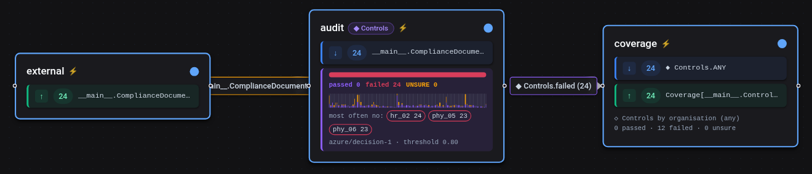
</p>

<p align="center">
  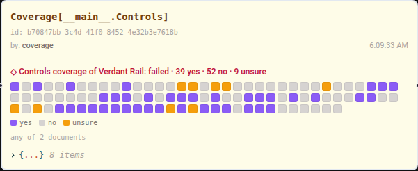
</p>

### Long documents in sections

A long document can exceed what a decision model reads well in one request, and one answer for the whole document does not say where the evidence is. `sections=` splits a text field into sections and decides each one:

```python
from flock import Sections

flock.agent("audit").consumes(Manual).decides(
    Controls, threshold=0.8, sections=Sections(field="text", max_chars=4000)
)
```

The field is split at paragraph boundaries (blank lines) into sections of at most `max_chars` characters; a longer paragraph is cut on its own, at a space where possible. Every question is asked about each section, with the rest of the artifact unchanged, and the answers are combined per question: a checklist item keeps the section with the most probable yes, so it is yes if any section shows it and no only if every section says no; a choice, yes/no or scale question keeps the most confident section. The decision's `sections` records the `field`, the sections' `spans` (`[start, end)` in the field) and `answered_by`: per question, or per checklist item, the section whose answer was kept, so `text[start:end]` is the evidence.

A refused section keeps an item from being no: without a yes from another section, the item stays `UNSURE`. `sections=` works with `escalate=` (every tier asks per section) and `shadow=`; it cannot be combined with `models=` or `tournament=` yet. Requests grow with the sections: one per section and per `questions_per_request` questions. Each pass over the sections (the decider's, an escalation tier's, a shadow's) sends at most 8 of them at a time; passes and evaluations run concurrently, so for a cap per decision model set `decision_rate_limit` ([Rate limits](#rate-limits)). A text with more than `max_sections` sections (default 100) fails before any request.

Use sections for documents that do not fit, or when the evidence has to be located. On documents that fit, deciding on the whole is more precise, because every section is another chance for a false yes. On 12 security manuals of 1,400 to 4,100 characters ([`12_long_documents.py`](https://github.com/whiteducksoftware/flock/blob/main/examples/15-decisions/12_long_documents.py), Microsoft-Decision-1, 100 controls):

| Decider | Requests | Precision of "yes" | Recall |
|---|---|---|---|
| whole manual | 12 | 0.87 | 0.96 |
| sections of at most 800 characters | 51 | 0.75 | 0.99 |

Recall counts an unsure answer about a shown control as missed: the whole manual leaves more shown controls unsure, so sections find a few more of them.

In the dashboard, a decision names the number of sections and, for a single question, the section that answered; a checklist cell names the section of its item in its tooltip:

<p align="center">
  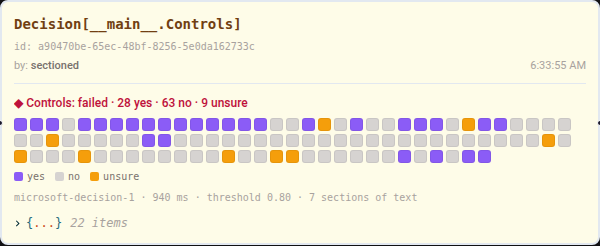
</p>

## Thresholds and the UNSURE branch

With `threshold=0.8` the decision is firm only when the chosen option's probability is at least 0.8. Otherwise `choice` is `UNSURE` and only `Route.UNSURE` subscribers run, typically an LLM agent or a human-in-the-loop step. This is a confidence-gated cascade: keep the confident verdicts, escalate the rest.

A **refused** question (OpenAI's Decisions API can refuse a question and still answer the others) becomes a decision with `choice=UNSURE`, `refused=True`, `best_guess=None` and no probabilities, so it lands in the `UNSURE` branch instead of failing the execution.

Calibration is per task, not global. Pick each decider's threshold on that decider's own data. Recorded decisions (persistent store, traces) make it cheap to replay inputs against another model before switching.

### Calibrating thresholds

With labels (the right answer for some decided artifacts), `calibrate()` suggests thresholds instead of guessing them:

```python
from flock.decisions.calibration import calibrate

suggestions = calibrate(decisions, labels, target_precision=0.95, min_support=5)
item_thresholds = {s.item: s.threshold for s in suggestions if s.item and s.threshold}

flock.agent("audit").consumes(Document).decides(
    Controls, threshold=0.8, item_thresholds=item_thresholds
)
```

`decisions` are decision artifacts (their producer is the decider; payloads or models work too, without a decider); `labels` maps a decided artifact's id to the right answer per question: `{"<artifact id>": {"Route": "tech"}}`, and for a Checklist a mapping of item to `"yes"` or `"no"`, `{"<artifact id>": {"Controls": {"mfa": "yes"}}}`. Per decider and question, and per checklist item, `calibrate()` returns a `Suggestion` with the lowest threshold whose firm answers reach `target_precision`, counting only thresholds with at least `min_support` labelled answers at or above them, and the `precision` and `coverage` (share of firm answers) at that threshold; `threshold` is `None` when no threshold reaches the target, and `note` says whether there were too few labels. A choice, yes/no or scale answer is its best guess with its probability (its `confidence` when the provider gave no probability, as in routing); a checklist item's answer is yes or no, whichever is more probable, with that probability. `item_thresholds=` on `.decides()` gives checklist items their own threshold, keyed by item (`"mfa"`) or, when several checklists of the decider share an item name, by `"Controls.mfa"`. `target_precision` must be in (0, 1] and `min_support` at least 1.

Human reviews are labels: `labels_from_reviews(decisions)` turns every [review](#human-review) into the right answer to its question about its subject, and the CLI calibrates a SQLite store from the decisions and reviews in it, per decider, and prints the thresholds exactly, ready to copy into `item_thresholds`:

```bash
flock decisions calibrate .flock/blackboard.db --target-precision 0.95 --min-support 5
```

Thresholds need enough labels. [`14_calibration.py`](https://github.com/whiteducksoftware/flock/blob/main/examples/15-decisions/14_calibration.py) calibrates the 100 controls on 12 of the 24 compliance documents (precision 0.95, at least 3 answers per threshold) and measures on the other 12 with Microsoft-Decision-1:

| Held-out documents | Precision of "shown" | Recall | Unsure answers |
|---|---|---|---|
| one threshold, 0.8 | 0.76 | 0.99 | 78 |
| calibrated item thresholds | 0.80 | 0.90 | 213 |

(Recall counts an unsure answer about a shown control as a miss.) Precision rises a little, but the target is far off on documents the thresholds were not fitted to, almost three times as many answers stay unsure, and recall drops: 12 labelled documents per control are too few for stable thresholds. Calibrate on as many labels as you can, and measure on labels the thresholds did not come from.

Calibration covers single-model deciders. With `escalate=` or `models=`, a threshold acts on each tier or vote rather than on the final answer, so `calibrate()` suggests nothing for those deciders (by the decisions' `mode`, also when every answer came from the first model) and says so in the suggestion's `note`. Decisions record the item thresholds that applied in `item_thresholds`.

In the dashboard, a decider names how many items have their own threshold and opens the list on click or with the keyboard; a checklist cell names its item's own threshold:

<p align="center">
  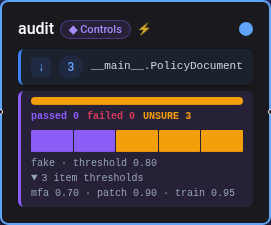
</p>

### Escalation cascades

`escalate=` asks another decision model about what the first one was not sure about, before anything routes to `UNSURE`:

```python
flock.agent("sorter").consumes(Paper).decides(
    ResearchField,
    model="azure/decision-1",
    escalate=["openai/gpt-6-luna"],
    threshold=0.9,
)
flock.agent("inbox").consumes(ResearchField.UNSURE).publishes(Parked)
```

1. The decider's own model answers every question.
2. A question whose answer is not firm (below `threshold` or refused) is asked again by the first model in `escalate=`, then by the next one, and so on. A tier gets only the questions the tier below was unsure about: of `.decides(Route, Urgent)` only `Urgent` may go up, and of a Checklist only its unsure items.
3. The last tier's answer is the decision. Still unsure after the last tier, it routes to `UNSURE` as usual.

The decision's `tier` says which tier answered (0 for `model=`, 1 for the first model in `escalate=`) and `model` names that tier's model. `attempts` lists the earlier answers, oldest first: each tier's `model`, `choice`, `probabilities`, `confidence` and `refused`; for a Checklist, the `model` and the `results` of the items that went up. Subscriptions and handles do not change: `ResearchField.computer_vision` runs whichever tier answered.

Each tier is a provider string or instance like `model=`, with its own share of `decision_rate_limit`. Every tier must accept images when the inputs hold an `Image`. `escalate=` cannot be combined with `tournament=` yet.

On 100 arXiv abstracts (nine fields, threshold 0.9), Microsoft-Decision-1 answered 82 papers firmly; `gpt-6-luna` answered 12 of the other 18, and 6 went to `UNSURE`. That took 118 requests, against 100 for each model alone; the stronger model saw 18 papers instead of 100 ([`07_escalation.py`](https://github.com/whiteducksoftware/flock/blob/main/examples/15-decisions/07_escalation.py)).

In the dashboard, a decider lists its cascade after its model (`azure/decision-1 › openai/gpt-6-luna`). An escalated decision shows its trail above the model line: every earlier tier's best guess and probability (amber), then the tier that answered:

<p align="center">
  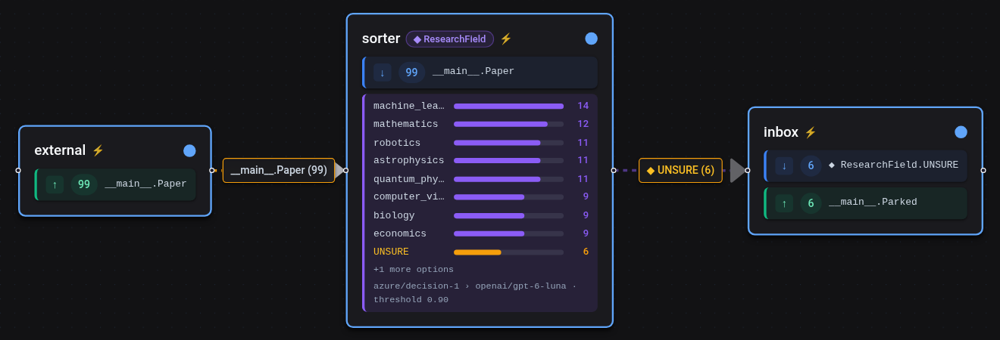
</p>

<p align="center">
  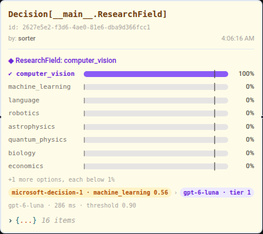
  &nbsp;&nbsp;
  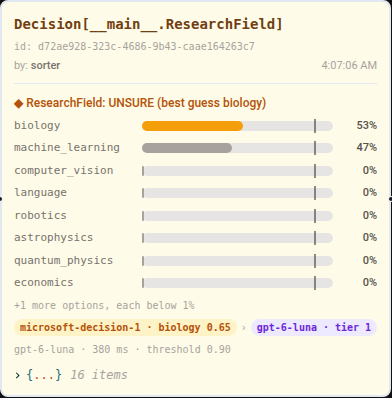
</p>

### Ensembles and voting

`models=` asks several decision models instead of one, and `vote=` decides:

```python
flock.agent("sorter").consumes(Paper).decides(
    ResearchField,
    models=["azure/decision-1", "jev/jev-latest", "openai/gpt-6-luna"],
    vote="majority",
    threshold=0.8,
)
flock.agent("inbox").consumes(ResearchField.UNSURE).publishes(Parked)
```

Every model answers every question, concurrently. A model's answer is a vote for its choice when it is firm: at or above `threshold` and not refused.

| `vote=` | Firm when |
|---|---|
| `"majority"` (default) | more than half of the models vote for the same answer |
| `"unanimous"` | every model votes for the same answer |
| `"mean"` | the mean probability of the most probable answer reaches `threshold` |

Anything else, disagreement included, routes to `UNSURE`. A refusal is no vote and counts against a majority; when every model refuses, the decision is refused. Checklist items are voted one by one, each with its own result.

The decision's `probabilities` are the mean over the models that answered, its `best_guess` is the answer voted for (or the most probable on average), and `model` joins the models' names (`microsoft-decision-1 + jev-1.13.0 + gpt-6-luna`). `votes` lists every model's answer in the order of `models=`: `model`, `choice`, `probabilities`, `confidence` and `refused`; for a Checklist, the `model` and its result per item.

With `options=`, a question left with one candidate or none is decided without asking any model, so its `votes` stay empty. `models=` replaces `model=` and needs at least two models; every model gets its own share of `decision_rate_limit` and must accept images when the inputs hold an `Image`. It cannot be combined with `escalate=` or `tournament=` yet.

On the 100 arXiv abstracts (threshold 0.8, one run per vote on 2026-10-11, [`08_voting.py`](https://github.com/whiteducksoftware/flock/blob/main/examples/15-decisions/08_voting.py)), each model alone and the three votes over the same three models:

| | Firm | Agree with arXiv | Of the firm ones |
|---|---|---|---|
| Microsoft-Decision-1 alone | 87 | 81 | 93 % |
| Jev alone | 89 | 82 | 92 % |
| `gpt-6-luna` alone | 95 | 91 | 96 % |
| `vote="majority"` | 89 | 84 | 94 % |
| `vote="mean"` | 84 | 81 | 96 % |
| `vote="unanimous"` | 80 | 78 | 98 % |

A vote trades coverage for precision: the unanimous vote sorted fewer papers, and almost all of them correctly. In this task one model is clearly stronger, and `gpt-6-luna` alone sorts more papers at about the same precision as the majority. An ensemble pays off when no model is clearly best, when a wrong firm answer costs more than a review, or when disagreement between models should be visible as its own branch. It costs one request per model.

In the dashboard, a decider names its vote and models (`majority of azure/decision-1 + jev/jev-latest + openai/gpt-6-luna`), and a decision shows every model's vote: violet for a firm vote for the decision, amber for a firm vote that did not carry, grey for no vote (below the threshold or refused).

<p align="center">
  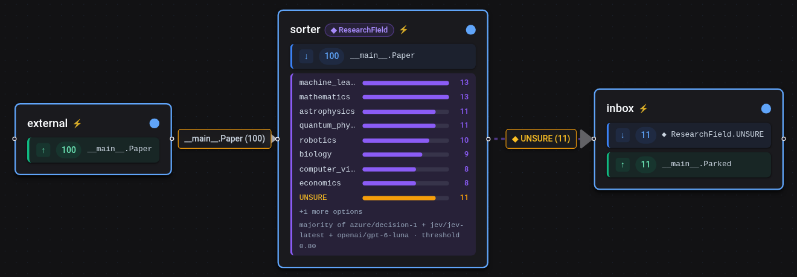
</p>

<p align="center">
  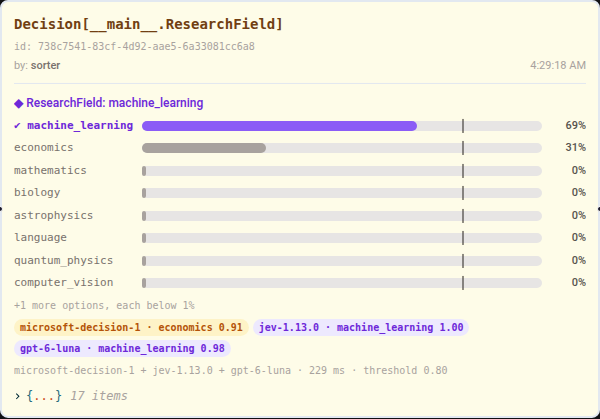
  &nbsp;&nbsp;
  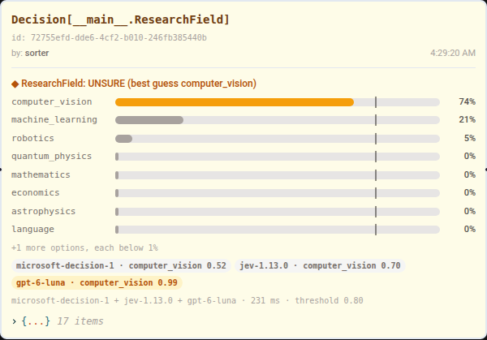
</p>

The mean bar of the chosen option can sit below the threshold marker on a majority decision: the threshold applies to each model's vote, not to the mean.

### Shadow mode

`shadow=` lets a candidate model answer along with the live one, before switching to it:

```python
flock.agent("sorter").consumes(Paper).decides(
    ResearchField, model="azure/decision-1", shadow="openai/gpt-6-luna", threshold=0.8
)
```

The shadow answers every question too, concurrently with the live model. Its answer is recorded in the decision's `shadow` and never routes: handles such as `ResearchField.UNSURE` see only the live choice. `shadow` holds the shadow's `model`, its `choice` under the same `threshold` (so it shows where the shadow would have routed), `best_guess`, `probabilities`, `confidence`, `refused` and `latency_ms`; for a Checklist, its `choice` (the outcome), `best_guess`, `results` and `refused_items`.

A failing shadow never fails the decision: a provider error, or images sent to a shadow without image support, is recorded as `{"model": ..., "error": ...}` and logged. A failing live model still fails the execution as before. After its own answer, the decision waits for the shadow at most `shadow_timeout` seconds (default 10); a slower shadow is cancelled and recorded as a timeout error, so it never holds up routing for long. `latency_ms` of the decision stays the live model's. `shadow=` combines with `escalate=`, `models=` and `options=`, and it cannot be combined with `tournament=` yet.

On the 100 arXiv abstracts (threshold 0.8, [`09_shadow.py`](https://github.com/whiteducksoftware/flock/blob/main/examples/15-decisions/09_shadow.py)), with Microsoft-Decision-1 live and `gpt-6-luna` in the shadow:

| | Firm | Agree with arXiv | Median latency |
|---|---|---|---|
| live: Microsoft-Decision-1 | 88 | 82 | 166 ms |
| shadow: `gpt-6-luna` | 95 | 91 | 140 ms |

The shadow would have routed 86 of the 100 papers the same way. Most of the other 14 are papers the live model was unsure about and the shadow sorted firmly; they are the papers to look at before the switch.

In the dashboard, the decider shows how often the shadow agreed (`shadow openai/gpt-6-luna · agrees 85/100` in a second run), and a decision shows the shadow's answer in a dashed pill: violet if it would have routed the same way, amber if not, grey if the shadow failed.

<p align="center">
  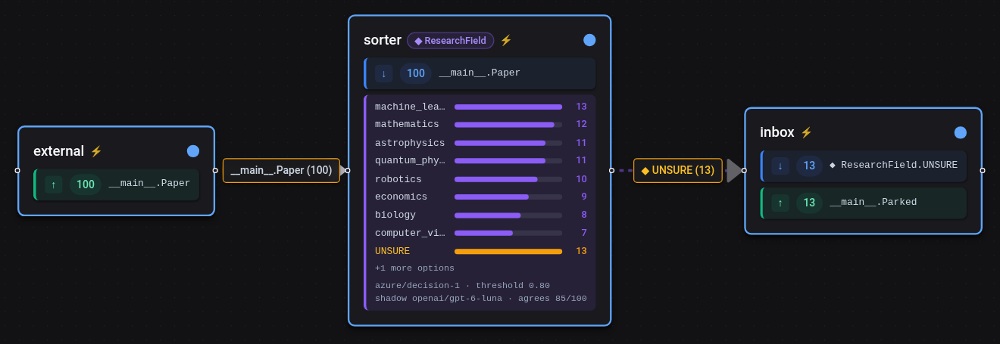
</p>

<p align="center">
  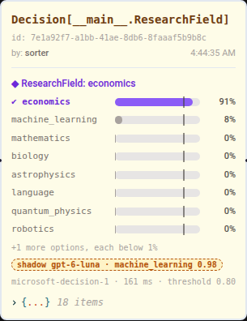
  &nbsp;&nbsp;
  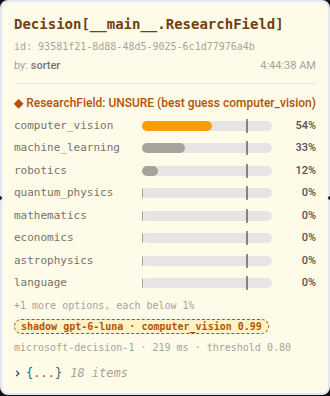
</p>

### Explain on demand

Decision models give probabilities, no reasons. An explaining agent asks an LLM for a reason, only for the decisions it subscribes to, usually the `UNSURE` branch:

```python
from flock.decisions.explain import Explanation

flock.agent("triage").consumes(Ticket).decides(Route, threshold=0.95)
flock.agent("explainer").consumes(Route.UNSURE).explains(model="openai/gpt-4.1")
flock.agent("review_queue").consumes(Explanation).publishes(ReviewItem)
```

For every decision that reaches it, the LLM gets the decided artifact (images included) and the decision: the question, the options and their criteria, the probabilities, the threshold and, for a Checklist, the result per item. With `options=`, only the evaluated candidates are shown; for a Checklist, the refused items are named. It writes an `Explanation`:

| Field | Meaning |
|---|---|
| `explanation` | Why the decision came out this way, citing the input |
| `missing` | Information that would settle the question, if any |
| `decision_ids`, `questions` | The explained decisions and their question names |
| `subject_ids` | The decided artifacts |
| `model` | The LLM that wrote the explanation |

The link fields are set by Flock, not by the LLM. The explanation quotes its subjects, so it keeps their visibility; for subjects with different visibilities, `visibility=` on `.explains()` sets the readership, and without it the explainer fails before the LLM is called. The default instructions ask the LLM to explain, not to answer the question itself; `instructions=` replaces them. `model=` defaults to the flock's model.

`.explains()` needs subscriptions to decision handles only (`Route.UNSURE`, `Controls.failed`, `Route.billing`, or several handles for an AND) and cannot be combined with `.publishes()`, `.with_engines()` or batch subscriptions. An execution without a decision (a trigger added later) is skipped without calling the LLM. With several handles, one explanation covers all decisions about the subject.

On eight support tickets with Microsoft-Decision-1 at threshold 0.95 ([`10_explain.py`](https://github.com/whiteducksoftware/flock/blob/main/examples/15-decisions/10_explain.py)), one ticket was unsure and the LLM ran once:

> **Return label not working** → UNSURE (shipping 0.90, tech 0.10)
> The subject and the reference to a "return label" support shipping, whose scope includes returns. However, "from the website gives an error when I print it" also suggests a technical bug, supporting tech as an alternative. [...]
> *Would settle it:* the exact error message and whether the failure occurs while generating the label on the website or while printing a downloaded one.

In the dashboard, an explanation shows as text instead of JSON, and the explained decision shows the start of the explanation on its card, also when the explanation is outside the view; its **more** button (click or keyboard) opens the whole text and what would settle it. The screenshots come from a second run, in which two tickets were unsure:

<p align="center">
  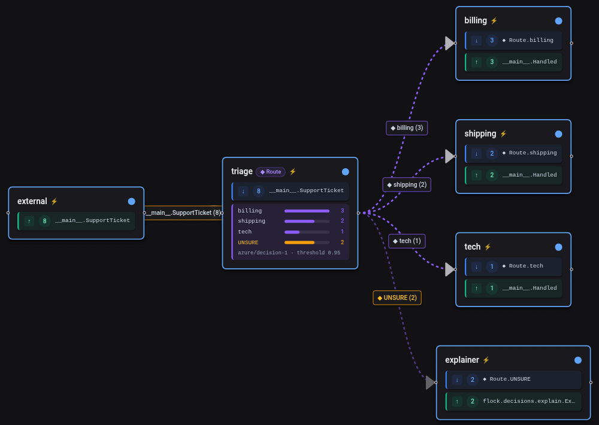
</p>

<p align="center">
  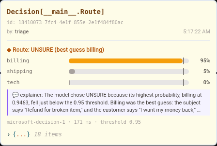
  &nbsp;&nbsp;
  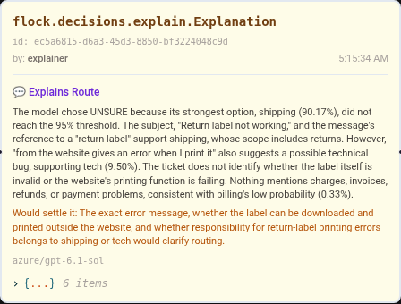
</p>

### Human review

When the decision model is not sure, a person can decide. A review publishes the person's answer as a decision of the same question about the same subject, so it routes like any other decision:

```python
flock.agent("triage").consumes(Ticket).decides(Route, threshold=0.95)
flock.agent("review_queue").consumes(Route.UNSURE).publishes(QueueItem)
flock.agent("tech").consumes(Route.tech).publishes(Reply)

# later, for an unsure decision
await flock.review(decision_id, choice="tech", reviewer="lead")  # the ticket reaches tech
await flock.review(other_id)  # without choice: confirm the best guess
```

The reviewed decision has the chosen option with probability 1.0, the reviewer as `model` and producer, `review_of` set to the reviewed decision's id, and the original's subjects, correlation and visibility; a scale review sets the score of the chosen level, so range handles match. Choice, yes/no and scale decisions can be reviewed; checklists cannot yet. An unknown id raises `LookupError`; an option the question does not have, or a reviewer named like one of the flock's agents (agents do not consume their own outputs, so the review would not reach that agent), raises `ValueError`.

The control API offers the same: `POST /api/control/decisions/{id}/review` with `{"choice": "tech", "reviewer": "lead"}` (both optional). In the Blackboard View, an unsure decision shows review buttons, the most probable options first; a click publishes the review. A reviewed decision then shows its review, and the review names the decision it replaces. A decision in view shows its review also when the review itself is outside the view, for example filtered out by producer. Reviewed decisions are labels: they record what a person decided where the model was not sure, which is the data needed to calibrate thresholds.

<p align="center">
  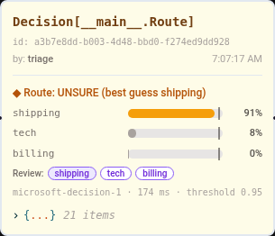
  &nbsp;
  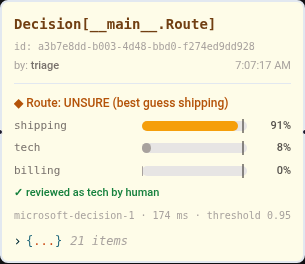
  &nbsp;
  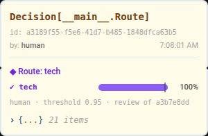
</p>

The reviewer appears as a producer in the Agent View, and the review routes the ticket like any decision:

<p align="center">
  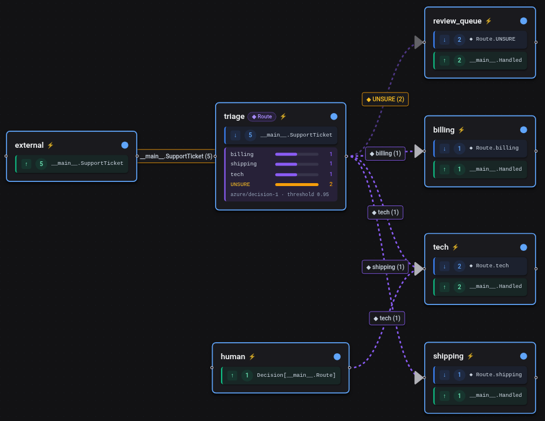
</p>

In [`13_human_review.py`](https://github.com/whiteducksoftware/flock/blob/main/examples/15-decisions/13_human_review.py), Microsoft-Decision-1 routes two of five tickets at threshold 0.95; a support lead reviews the other three in code (one override, two confirmations), and each ticket reaches the team the lead chose.

## Visibility

A decision inherits the visibility of its subject, so routing never widens who can read data. Agents that may not see the ticket do not see its decision either and are not triggered. If a decider consumes several inputs with different visibilities, it fails instead of guessing; pass `visibility=` to `.decides()` to choose the decision's readership explicitly.

## Dashboard

A decider node shows every question it asks, drawn by kind: option bars for a `Choice`, one bar split into yes, no and `UNSURE` for a `YesNo`, and a histogram of the levels in order for a `Scale`, with a marker at the mean weighted score. Edges carry the answer, qualified for yes/no and scale questions (`Urgent.yes`, `Anger.angry`):

<p align="center">
  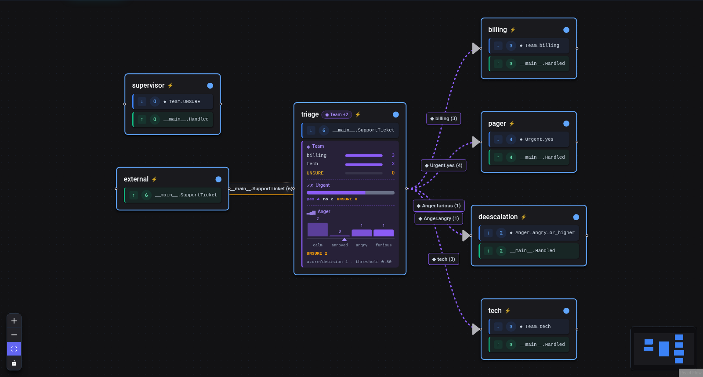
</p>

In the Blackboard View each decision shows its answer the same way. A yes/no decision is one bar from yes (left) to no (right); the hatched zone between the two threshold markers is where neither answer is firm. A scale decision shows its levels in order, the threshold as a dashed line and the weighted score as a dot on the axis:

<p align="center">
  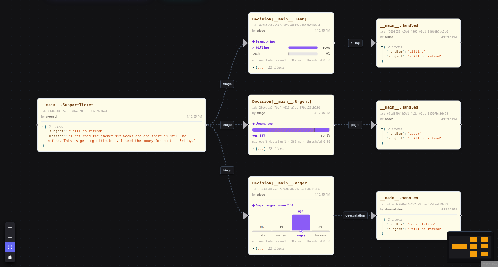
</p>

<p align="center">
  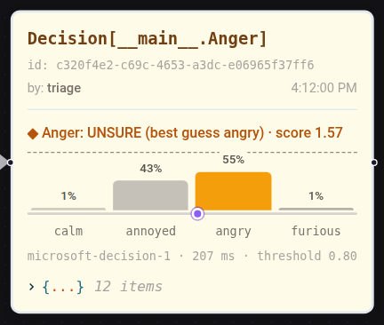
</p>

A checklist decider shows its outcomes, a strip with one column per item (the share of `yes` in violet and of unsure answers in amber across all decisions) and the items answered "no" most often. A checklist decision shows one cell per item:

<p align="center">
  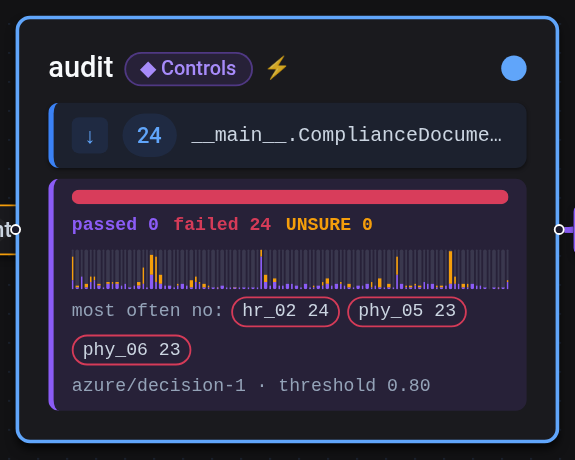
  &nbsp;&nbsp;
  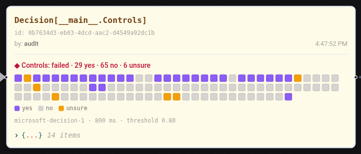
</p>

## Images

Decision models that accept images can decide about pictures. Put the picture into the artifact as a `flock.Image` field:

```python
from flock import Choice, Flock, Image, flock_type


@flock_type
class ProductPhoto(BaseModel):
    sku: str
    photo: Image


class Condition(Choice):
    """Is the product in the photo damaged?"""

    intact = "No visible damage"
    damaged = "Cracks, dents, tears or broken parts"


flock.agent("inspector").consumes(ProductPhoto).decides(Condition, model="openai/gpt-6-luna")

await flock.publish(ProductPhoto(sku="A-17", photo=Image.from_file("a17.jpg")))
```

- `Image` holds the picture as a base64 `data:image/...` URL, so it round-trips through stores, the REST API and the dashboard. Only inline data is accepted: Flock never fetches an image from a URL or a file path named in an artifact. Images over 20 MB or 50 million pixels are rejected when the artifact is created.
- `Image.from_file()`, `Image.from_bytes()` and `Image.from_pil()` scale the picture down to `max_side` (default 1024 px) and re-encode it as JPEG (PNG when it has transparency). Re-encoding drops EXIF metadata such as GPS positions. Smaller images are faster: a local Clef model took 1.3 s for a 108 KB photo and 11 s for 1 MB.
- The decider sends every `Image` in its inputs (also nested, in order) to the model; the text state shows `<image 1>`, `<image 2>`, ... in their place.
- LLM agents receive `Image` fields as pictures too; see [image inputs](dspy-engine.md#image-inputs).
- Limits, publishing paths and security rules for images: [Images guide](images.md).
- A text-only provider refuses image inputs with a clear error instead of dropping the images.

| Provider | Images |
|---|---|
| `openai/<model>` | yes (`input_image` parts) |
| `local/<name>` | yes, if the served model has vision support (top-level `images`, raw base64) |
| `azure/<deployment>` (Microsoft-Decision-1) | no |
| `jev/<model>` | no |

In the dashboard, a decider's options show lanes with thumbnails of the latest images sorted into each option, and a decision artifact shows the decided image next to its probabilities. Image fields render as thumbnails instead of base64 text.

<p align="center">
  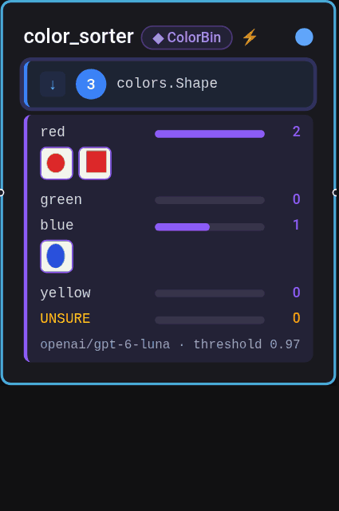
</p>

In the Blackboard View every image artifact shows its thumbnail, and each decision shows the image it decided on, its probabilities and the threshold:

<p align="center">
  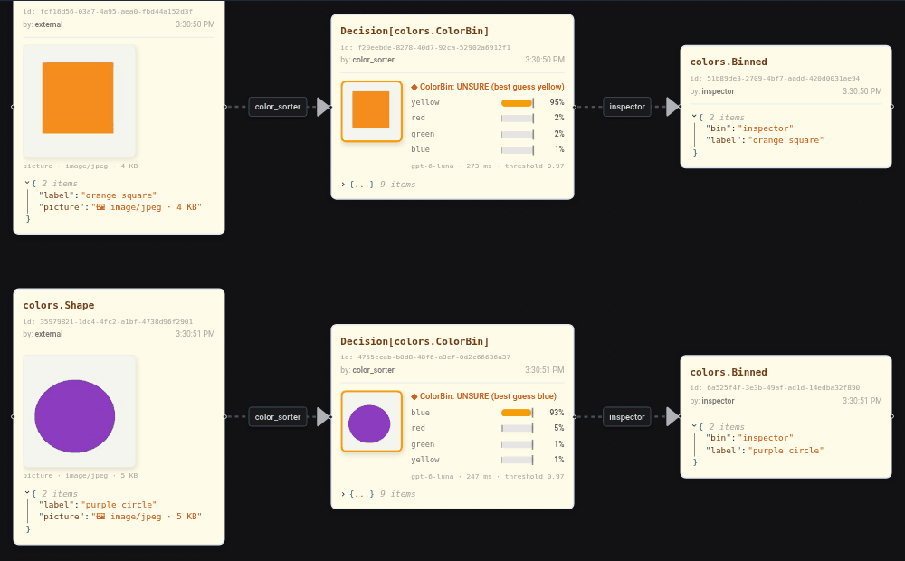
</p>

## Providers

| Model string | Protocol | Configuration |
|---|---|---|
| `jev/<model>` | `POST /v1/systemone` | `JEV_API_KEY` (`JEV_API_BASE` overrides the endpoint) |
| `local/<name>` | `POST /v1/systemone` | `DECISION_API_BASE`, default `http://127.0.0.1:8080` |
| `azure/<deployment>` | `POST /v1/systemone` on Azure AI Foundry (Microsoft-Decision-1) | `AZURE_API_BASE`, `AZURE_API_KEY`; `AZURE_DECISION` overrides the path (default `/providers/microsoft/v1/systemone`) or sets a full URL; `azure/` alone uses `AZURE_DECISION_DEPLOYMENT` |
| `openai/<model>` | `POST /v1/decisions` | `OPENAI_API_KEY` |

Set the decision model once for the whole flock instead of on every decider:

```python
flock = Flock("openai/gpt-4.1", decision_model="azure/decision-1")

flock.agent("triage").consumes(Ticket).decides(Route)               # azure/decision-1
flock.agent("audit").consumes(Document).decides(Controls)           # azure/decision-1
flock.agent("painter").consumes(Swatch).decides(Color, model="openai/gpt-6-luna")  # explicit wins
```

The order is `model=` on `.decides()`, then `Flock(decision_model=...)` (a model string or a `DecisionProvider`), then the `DEFAULT_DECISION_MODEL` environment variable.

The live tests (`FLOCK_LIVE_DECISIONS=1 uv run pytest tests/decisions/test_live_providers.py`) run against `azure/decision-1` by default and add the other providers when their configuration is present.

### Local models

Any server that speaks `POST /v1/systemone` works with `local/`. llama.cpp's server runs Clef GGUF files with the decision head:

```bash
llama serve -m Clef-Flash-Q8_0.gguf -b 4096 -ub 4096 -ngl 99
```

The model evaluates the whole prompt in one batch, so `-b` and `-ub` must cover the longest request.

### Rate limits

Hosted decision models limit the requests per period. The Microsoft-Decision-1 deployment used by the examples, for example, allows 100 requests per minute. Two mechanisms keep deciders within such limits:

- **Retries.** A request answered with HTTP 429 (rate limited) or 503 (overloaded) is sent again, up to 7 times.
    - The response's advice is the shortest wait: `retry-after-ms`, `Retry-After` or `x-ratelimit-reset-requests`, which hold seconds on Azure and durations such as `6m0s` on OpenAI.
    - On top comes a backoff that doubles from 0.5–1 s, with jitter. Azure advises the time until its next free request, often under half a second. A burst of rejected requests that all came back after exactly that would be rejected together again.
    - No single wait exceeds 60 s. The shortest waits add up to just over a minute, one full rate-limit window.
    - Each retry logs a warning, and `max_retries=` on the provider classes changes the count.
- **A request budget.** `decision_rate_limit` spaces out requests before the limit is reached:

    ```python
    flock = Flock(decision_model="azure/decision-1", decision_rate_limit="100/min")
    ```

    Each decision model gets at most this many request starts per period (`"N/s"`, `"N/min"` or `"N/h"`). The budget is shared by every decider of the flock that uses the model, whichever way the model was set. Requests over the budget wait for a free slot in arrival order, and retries count against it. Without `decision_rate_limit`, requests go out at once.

The budget covers one flock. When other clients share the deployment, the retries absorb their share of the limit. Waiting time is part of a decision's `latency_ms`.

### Errors

Provider failures (unreachable server, HTTP errors, answers with unknown options) fail the decider's execution and publish a `WorkflowError`, as does an HTTP 429 or 503 that persists through all retries. Error messages name the provider and the HTTP status only, never the response body, because a body can echo the decided data.

## Testing

`FakeDecider` answers with fixed probabilities or with a function of the state and records every request:

```python
from flock.decisions import FakeDecider

decider = FakeDecider({"billing": 0.9, "shipping": 0.05, "tech": 0.05})
flock.agent("triage").consumes(Ticket).decides(Route, model=decider)

await flock.publish(ticket)
await flock.run_until_idle()

state, question = decider.calls[0]
```

For a decider with several questions, give the probabilities per question name. `refuse=` makes it refuse questions; `decider.requests` holds every request with all its questions:

```python
decider = FakeDecider(
    {
        "Route": {"billing": 0.9, "tech": 0.1},
        "Urgent": {"yes": 0.8, "no": 0.2},
        "Anger": {"calm": 0.1, "annoyed": 0.2, "angry": 0.6, "furious": 0.1},
    },
    refuse={"Urgent"},  # optional
)
```

For a checklist, map its name to the probability of yes per item (or to a function of the state returning that); refuse single items as `"Controls.restore_test"`:

```python
decider = FakeDecider({"Controls": {"mfa": 0.97, "backup": 0.95, "restore_test": 0.1}})
```

## Decision models or semantic subscriptions?

Both route artifacts by meaning, at different costs and guarantees:

| | Semantic subscriptions (`semantic_match=`) | Decision models (`.decides()`) |
|---|---|---|
| How | Embedding similarity of the artifact text to a query, per subscriber | One model call per artifact answers a question with a probability per option |
| Runs | Locally (`all-MiniLM-L6-v2`), no API | Hosted (`azure/`, `openai/`, `jev/`) or a local server (`local/`) |
| Output | A similarity score per subscriber, not shared | A `Decision` artifact on the blackboard: probabilities, confidence, audit trail |
| Mutually exclusive branches | No: several subscribers can match one artifact | Yes: exactly one option, or `UNSURE` |
| Good for | Cheap relevance filters, "is this about X?" | Routing and classification you want to audit, threshold and replay |

## What decision models are good at

They judge well when the answer can be read off the supplied state: routing, intent and topic classification, policy checks against given text. They are weak at reference-free judgments of taste or quality, where their confidence stops predicting their errors. They give no reasons, so let an LLM explain the low-confidence and failing cases. A decision model should not be the only gate that allows a risky action; let it deny or escalate, and let allowlists or people allow.

## Example

[`examples/15-decisions/01_ticket_triage.py`](https://github.com/whiteducksoftware/flock/blob/main/examples/15-decisions/01_ticket_triage.py) routes support tickets with Microsoft-Decision-1 (or any other provider) and sends ambiguous tickets to a supervisor. [`02_arxiv_race.py`](https://github.com/whiteducksoftware/flock/blob/main/examples/15-decisions/02_arxiv_race.py) races an LLM against the available decision models on 100 arXiv abstracts. [`03_color_sorter.py`](https://github.com/whiteducksoftware/flock/blob/main/examples/15-decisions/03_color_sorter.py) sorts generated shapes into color bins from their images. [`04_question_types.py`](https://github.com/whiteducksoftware/flock/blob/main/examples/15-decisions/04_question_types.py) asks a choice, a yes/no and a scale question about every ticket in one request. [`05_compliance_checklist.py`](https://github.com/whiteducksoftware/flock/blob/main/examples/15-decisions/05_compliance_checklist.py) checks 24 fictional security documents against 100 controls and compares the answers with ground truth. [`06_control_mapping_tournament.py`](https://github.com/whiteducksoftware/flock/blob/main/examples/15-decisions/06_control_mapping_tournament.py) maps evidence sentences to one of the 100 controls in three ways: a single choice, a tournament and a screening network. [`07_escalation.py`](https://github.com/whiteducksoftware/flock/blob/main/examples/15-decisions/07_escalation.py) sorts the arXiv abstracts with a cascade of two decision models and shows which tier answered each paper. [`08_voting.py`](https://github.com/whiteducksoftware/flock/blob/main/examples/15-decisions/08_voting.py) lets three decision models vote on them and compares each model with the ensemble. [`09_shadow.py`](https://github.com/whiteducksoftware/flock/blob/main/examples/15-decisions/09_shadow.py) runs a candidate model in the shadow of the live one and lists where it would have routed differently. [`10_explain.py`](https://github.com/whiteducksoftware/flock/blob/main/examples/15-decisions/10_explain.py) lets an LLM explain the tickets the router was unsure about. [`11_coverage.py`](https://github.com/whiteducksoftware/flock/blob/main/examples/15-decisions/11_coverage.py) combines the compliance checklists per organisation. [`12_long_documents.py`](https://github.com/whiteducksoftware/flock/blob/main/examples/15-decisions/12_long_documents.py) checks long manuals in sections and shows where each control is shown. [`13_human_review.py`](https://github.com/whiteducksoftware/flock/blob/main/examples/15-decisions/13_human_review.py) lets a person review the unsure tickets. [`14_calibration.py`](https://github.com/whiteducksoftware/flock/blob/main/examples/15-decisions/14_calibration.py) calibrates a threshold per control and measures it on held-out documents.
