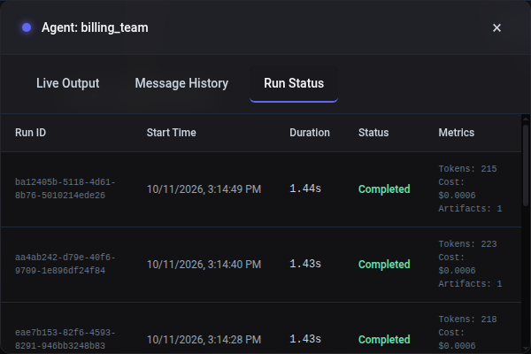

# Configuration Reference

## Environment Variables and .env Files

Flock automatically loads environment variables from `.env` files in the current directory when the package is imported. This provides a convenient way to manage configuration without manually setting environment variables.

### Automatic .env Loading

When you import Flock, it will automatically:
1. Look for a `.env` file in the current working directory
2. Load all environment variables from that file
3. Make them available via `os.getenv()` throughout the application

```python
# This will automatically load .env file if it exists
from flock import Flock

flock = Flock()  # Will use DEFAULT_MODEL from .env if available
```

### Creating a .env File

Create a `.env` file in your project root:

```bash
# Choose a default model for your environment
DEFAULT_MODEL=openai/gpt-4.1
# DEFAULT_MODEL=azure/gpt-4.1

# OpenAI
OPENAI_API_KEY=your_openai_api_key_here

# Azure OpenAI (API-key path)
AZURE_API_KEY=your_azure_api_key_here
AZURE_API_BASE=https://your-resource.openai.azure.com/
AZURE_API_VERSION=2024-12-01-preview

# Tracing
FLOCK_AUTO_TRACE=true
FLOCK_TRACE_FILE=true
FLOCK_TRACE_LEVEL=agents  # or all, to trace Flock's internals too
FLOCK_TRACE_SERVICES=["flock", "agent", "dspyengine"]
```

## Azure OpenAI Authentication

Flock works with LiteLLM's Azure provider. `DEFAULT_MODEL` is resolved by Flock and `DSPyEngine`, while Azure connection settings such as `AZURE_API_BASE`, `AZURE_API_VERSION`, and `AZURE_API_KEY` are consumed by the underlying LiteLLM-backed `dspy.LM(...)`.

### API-key Authentication

The existing API-key flow remains supported:

```bash
DEFAULT_MODEL=azure/gpt-4.1
AZURE_API_KEY=your_azure_api_key_here
AZURE_API_BASE=https://your-resource.openai.azure.com/
AZURE_API_VERSION=2024-12-01-preview
```

With that configuration in place, `DSPyEngine(model="azure/gpt-4.1")` works without any extra code.

### Entra ID / DefaultAzureCredential Authentication

For token-based auth, install the Azure auth dependency:

```bash
uv sync --extra azure
```

Then keep the Azure endpoint settings in `.env` and create the token provider in code:

```bash
DEFAULT_MODEL=azure/gpt-4.1
AZURE_API_BASE=https://your-resource.openai.azure.com/
AZURE_API_VERSION=2024-12-01-preview
```

```python
from flock.engines import DSPyEngine
from flock.engines.auth.azure import get_default_azure_token_provider

engine = DSPyEngine(
    lm_kwargs={
        "azure_ad_token_provider": get_default_azure_token_provider(),
    }
)
```

The helper also accepts custom `scopes=` values and forwards additional keyword arguments to `DefaultAzureCredential(...)` when you need to tune the Azure identity chain. For the Azure AI Foundry **Agents** API, pass `AZURE_AI_FOUNDRY_SCOPE`:

```python
from flock.engines.auth.azure import AZURE_AI_FOUNDRY_SCOPE, get_default_azure_token_provider

token_provider = get_default_azure_token_provider(scopes=AZURE_AI_FOUNDRY_SCOPE)
```

### Provider-specific `lm_kwargs`

`DSPyEngine(lm_kwargs={...})` forwards extra keyword arguments to the `dspy.LM(...)` instance created by the engine. That passthrough is how Azure token providers, or any other provider-specific LM arguments supported by DSPy/LiteLLM, are attached.

Keep these reserved keys out of `lm_kwargs`: `model`, `temperature`, `max_tokens`, `max_completion_tokens`, `cache`, and `num_retries`. Use the dedicated engine field when one exists.

If an adapter creates its own `dspy.LM(...)` instance, configure that LM directly. `lm_kwargs` only affects the engine-managed LM. The [DSPy Engine guide](../guides/dspy-engine.md) shows both patterns.

### Available Environment Variables

See the [.envtemplate](https://github.com/whiteducksoftware/flock/blob/main/.envtemplate) file for a complete list of all available configuration options.

### Manual Environment Variable Loading

If you need to load environment variables from a custom location:

```python
from dotenv import load_dotenv
load_dotenv('/path/to/your/.env')  # Load from custom path

from flock import Flock
```

### Priority Order

Environment variables are resolved in this order:
1. System environment variables (highest priority)
2. `.env` file variables
3. Default values in the code (lowest priority)

## Configuration Options

For detailed configuration options, see:
- [Installation Guide](../getting-started/installation.md) for environment setup
- [.envtemplate](https://github.com/whiteducksoftware/flock/blob/main/.envtemplate) for all available options

## Token usage and cost

Every agent run reports the tokens its models used and what they cost:

- **LLM agents:** the DSPy engine records the usage LiteLLM reports for every request of a run, also when it streams.
- **Decision agents:** each request to a decision model counts its input tokens once, whatever the number of questions in it, including escalation tiers, votes, sections and the shadow. A shadow request cancelled at `shadow_timeout` returns no usage and is not counted. Decision models generate no text, so they have no output tokens.

The run's metrics (`ctx.state["metrics"]`, the dashboard's Run Status, `AgentCompletedEvent.metrics`) carry:

- `prompt_tokens`, `completion_tokens` and `tokens_used`;
- `usage`, the tokens per model;
- `cost_usd`;
- `unpriced_models`.

The run's trace gets `flock.usage.tokens` and `flock.usage.cost_usd`. A failed run reports the requests it made before it failed.

A custom engine reports usage, as model -> tokens, in one of two ways:

- `report_usage({"my/model": {"prompt_tokens": 120, "completion_tokens": 40}})` from `flock.utils.usage`, as soon as the model answers, which counts even if the engine fails afterwards;
- the same mapping in `EvalResult.metrics["usage"]`, counted when the engine returns.

Costs come from LiteLLM's price table. For models it does not know, such as a decision model deployment or a local model, give prices in USD per million tokens:

```python
flock = Flock(
    "azure/gpt-4.1",
    decision_model="azure/decision-1",
    model_prices={"azure/decision-1": (0.5, 0.0)},  # (input, output) per million tokens
)
```

Configured prices win over LiteLLM's. A run that used a model without a price reports its tokens, `cost_usd` None and the model in `unpriced_models`. Cached LLM answers cost nothing and are not counted.

The dashboard's Run Status lists each run of an agent with its tokens and cost (`GET /api/agents/{name}/runs`); the [dashboard demo](https://github.com/whiteducksoftware/flock/blob/main/examples/04-misc/10_dashboard_triage_demo.py) reports both at demo prices:

<p align="center">
  
</p>

## Storage Backends

Flock can run with different blackboard backends:

- In-memory blackboard (default, no extra setup)
- SQLite durable history (single-node persistence)
- Dapr-backed state stores (distributed backend, optional dependency)

See:
- [Persistent Blackboard History](../guides/persistent-blackboard.md)
- [Dapr State Store Integration](../guides/dapr-state-store.md)
- [DSPy Engine Guide](../guides/dspy-engine.md) for `lm_kwargs`, adapters, and Azure auth wiring
- [Tracing Configuration](../guides/tracing/) for telemetry settings
